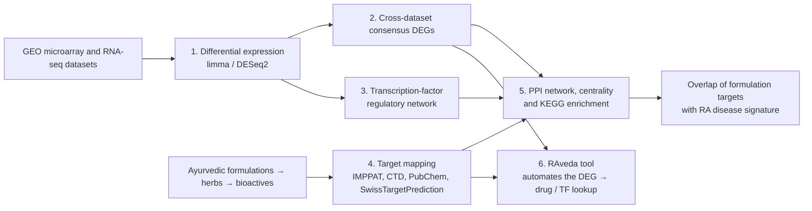
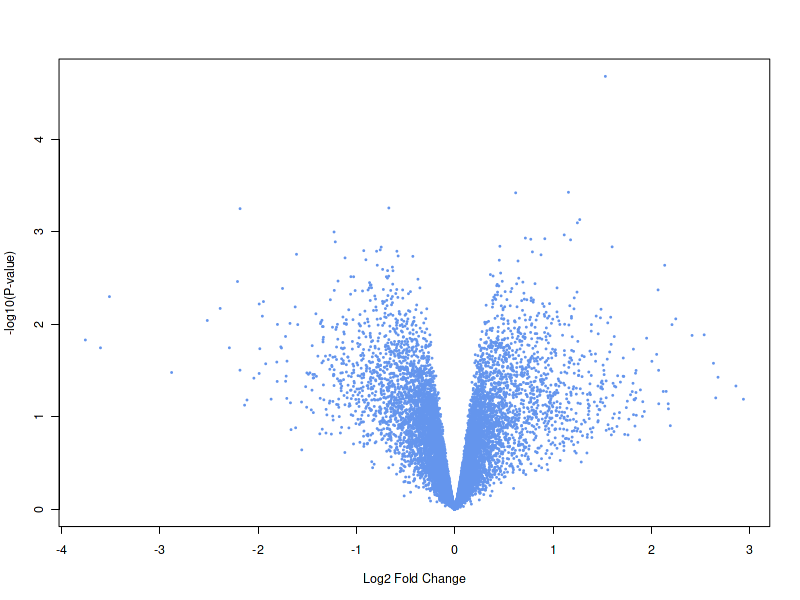

# Network-Based Analysis of Ayurvedic Formulations in Rheumatoid Arthritis

MSc thesis project (Biotechnology & Bioinformatics, Institute of Bioinformatics and Applied Biotechnology, Bengaluru; Bangalore University), May 2025.
Supervisor: Prof. R. Srivatsan. Author: Riddhima Das.

📄 Full write-up: [`docs/thesis_Network-Based_Analysis_of_Ayurvedic_Formulations_in_RA.pdf`](docs/thesis_Network-Based_Analysis_of_Ayurvedic_Formulations_in_RA.pdf) · Slides: [`docs/final_project_slides.pdf`](docs/final_project_slides.pdf)

---

## The question

Rheumatoid arthritis (RA) is a chronic autoimmune disease of the joints. Current drugs can cause side effects, work incompletely and are costly, and Ayurvedic herbal formulations are widely used alongside them, but their molecular rationale is poorly mapped.
This project asks: **do the bioactive compounds in RA-prescribed Ayurvedic formulations act on the same genes and pathways that are dysregulated in RA patients?**

## Approach

The project combines patient transcriptomics with compound–target network pharmacology.



| Stage | What was done | Main tools | Folder |
|---|---|---|---|
| 1. DEG analysis | RMA normalisation, QC plots, limma moderated t-test, volcano plots and heatmaps for synovial (GSE10500) and whole-blood (GSE93272) microarray data | R: `oligo`, `limma`, `pheatmap` | [`01_microarray_deg_analysis`](01_microarray_deg_analysis) |
| 2. Cross-dataset comparison | Compared DEGs across 5 microarray datasets and 3 RNA-seq contrasts (control/early/late RA) to find consistently dysregulated genes | R: `dplyr` | [`02_cross_dataset_comparison`](02_cross_dataset_comparison) |
| 3. TF network | Found DEGs that are transcription factors, the genes they regulate (ENCODE TF targets), and overlap with a curated 212-gene RA list | R: `igraph`, `ggraph` | [`03_tf_network_analysis`](03_tf_network_analysis) |
| 4. Bioactive → target mapping | Formulations → herbs → bioactive compounds → predicted/known targets; overlap with RA genes | IMPPAT, CTD, SwissADME, PubChem, SwissTargetPrediction, Python, R | [`04_bioactive_target_mapping`](04_bioactive_target_mapping) |
| 5. Network & pathway analysis | STRING PPI networks, degree/betweenness/closeness centrality, KEGG enrichment (DAVID), formulation–pathway networks | STRING, DAVID, Python: `networkx` | [`05_network_and_pathway_analysis`](05_network_and_pathway_analysis) |
| 6. RAveda tool | Streamlit app that, given a user's DEG table, returns matching Ayurvedic drugs, DEG transcription factors and an interactive TF → RA-gene network | Python: `streamlit`, `pyvis`, `plotly` | [`06_raveda_tool`](06_raveda_tool) |

## Datasets

| Dataset | Type | Tissue | Control / RA | Thresholds (\|logFC\|, p, adj. p) | DEGs | Platform |
|---|---|---|---|---|---|---|
| GSE10500 | microarray | synovial macrophages vs. blood-derived macrophages | 3 / 5 | 1, 0.05, – | 230 | Affymetrix HG-U95Av2 |
| GSE93272 | microarray | whole blood (subset of samples) | 10 / 10 | 0.76, 0.05, 0.1 | 716 | Affymetrix HG-U133 Plus 2.0 |
| GSE55235 | microarray | synovium | 20 / 33 | 1, 0.05, 0.1 | 639 | Affymetrix HG-U133A |
| GSE206848 | microarray | synovium | 4 / 2 | 0.857, 0.05, 0.2 | 61 | Affymetrix HG-U133 Plus 2.0 |
| GSE77298 | microarray | synovium | 7 / 16 | 1.2, 0.05, 0.1 | 710 | Affymetrix HG-U133 Plus 2.0 |
| GSE89408 | RNA-seq | synovium | 28 / 152 | 1, 0.01, 0.01 | 3,895 (control vs early), 4,527 (control vs late), 101 (early vs late) | Illumina |

Raw data are not stored here; download them from [GEO](https://www.ncbi.nlm.nih.gov/geo/) using the accessions above.
GSE10500 and GSE93272 were analysed with the scripts in this repository. The other datasets were analysed as part of the wider project and used for the cross-dataset consensus (Stage 2); their per-gene tables are not redistributed here.

## Key findings

- **RA-relevant pathways** were enriched among GSE10500 DEGs (KEGG via DAVID, BH-adjusted p < 0.05): MAPK, NF-κB, apoptosis, T-cell receptor signalling and osteoclast differentiation. *JUN* appeared in nearly all of them.
- **Five DEG transcription factors** (SPI1, RCOR1, JUN, IKZF1, ZEB1) regulate between 52 and 203 genes each, and together control RA-listed genes such as *ACP5, IL15, VEGFA, PFKFB3, PFKP, FLT1*.
- ***HCK*** was the single gene dysregulated in all four synovial/macrophage microarray datasets compared (GSE10500, GSE55235, GSE206848, GSE77298); a separate set of 22 genes was shared by GSE55235, GSE206848 and GSE77298.
- **Bioactives converge on the disease network.** Compounds such as withaferin A, curcumin, ellagic acid and guggulsterone target *TNF, IL6, IL1B, MAPK1, PTGS2, ALOX5, TLR4* and *RELA*. In the STRING network of their targets (confidence ≥ 0.9, first shell), 128 pathways were affected and four modules emerged: cytokines, chemokines, signal transduction and matrix remodelling.
- **Pathway convergence** between the transcriptomic signature and the bioactives' targets: Th17 differentiation, Toll-like receptor, MAPK, NF-κB and cytokine–cytokine receptor signalling.
- **Three formulations dissected** (Ashwashila, Articulin F, Triphala Guggul) show complementary and partly redundant target profiles, for example several compounds from different herbs in Articulin F all target *ALOX5*.



## Reproducing the analysis

**Requirements**
- R ≥ 4.2 with Bioconductor packages: `oligo`, `limma`, `multtest`, `hgu95av2.db`, `pd.hg.u95av2`, `hgu133plus2.db`, `pd.hgu133plus2`, `pheatmap`, `Cairo`; CRAN: `dplyr`, `readr`, `readxl`, `igraph`, `ggraph`, `ggplot2`. See [`r_packages.R`](r_packages.R).
- Python ≥ 3.9: `pip install -r requirements.txt`

**Run order**
1. Download the `.CEL` files from GEO into `01_microarray_deg_analysis/<dataset>/data_files/` and run the limma script in each folder.
2. Download `gene_attribute_edges.txt` from Harmonizome ([ENCODE Transcription Factor Targets](https://maayanlab.cloud/Harmonizome/dataset/ENCODE+Transcription+Factor+Targets)) into `03_tf_network_analysis/` and run the numbered scripts there.
3. `python 05_network_and_pathway_analysis/centrality_analysis.py --input 05_network_and_pathway_analysis/data/string_interactions_bioactive_targets.tsv --name bioactive_targets`
4. `streamlit run 06_raveda_tool/app.py`

Each folder has its own README with inputs, outputs and notes.

## Scope and limitations

- Several steps used **web tools** (DAVID, STRING, IMPPAT, CTD, SwissADME, SwissTargetPrediction, PubChem, Dravya). They are described in the thesis (Chapter 3) and the exported results are included, but they are not scripted.
- RNA-seq read processing (FastQC → trimming → Bowtie2 → featureCounts → DESeq2, thesis §3.1.4) is described in the thesis but its code is not part of this repository.
- GSE10500 has very few samples (3 vs 5) and its controls are blood-derived macrophages rather than healthy synovium, and its DEG list uses an unadjusted p-value cut-off; it is best read as hypothesis-generating, and its results were cross-checked against the other datasets (thesis §3.2.5).
- Targets are a mix of experimentally reported (PubChem, CTD) and predicted (SwissTargetPrediction) interactions. All conclusions are computational and have not been experimentally validated; wet-lab validation is the proposed next step (thesis §5.2).

## Repository layout

```
docs/                              thesis and slides
01_microarray_deg_analysis/        limma pipelines, DEG tables, QC and result figures
02_cross_dataset_comparison/       overlap of microarray / RNA-seq DEGs with known targets
03_tf_network_analysis/            DEG transcription factors, targets, RA-gene overlap, plots
04_bioactive_target_mapping/       formulations, bioactives, target tables, PubChem/SwissTarget overlaps
05_network_and_pathway_analysis/   centrality, KEGG pathway overlap, formulation–pathway networks
06_raveda_tool/                    Streamlit app and its reference data
```
